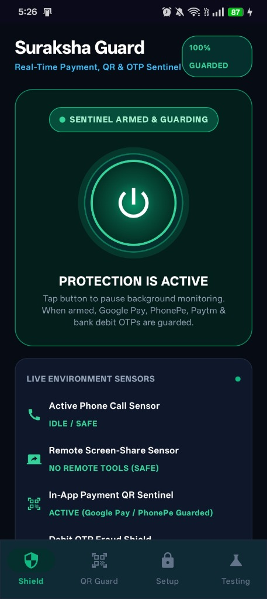
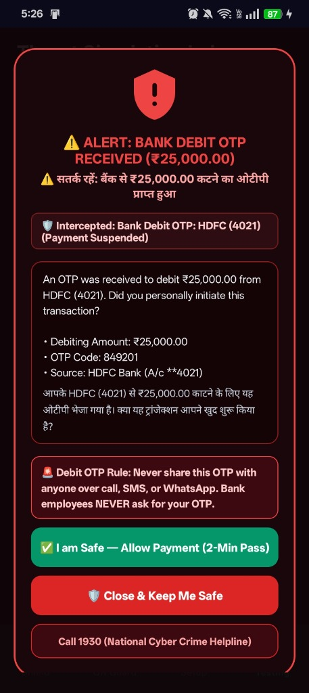
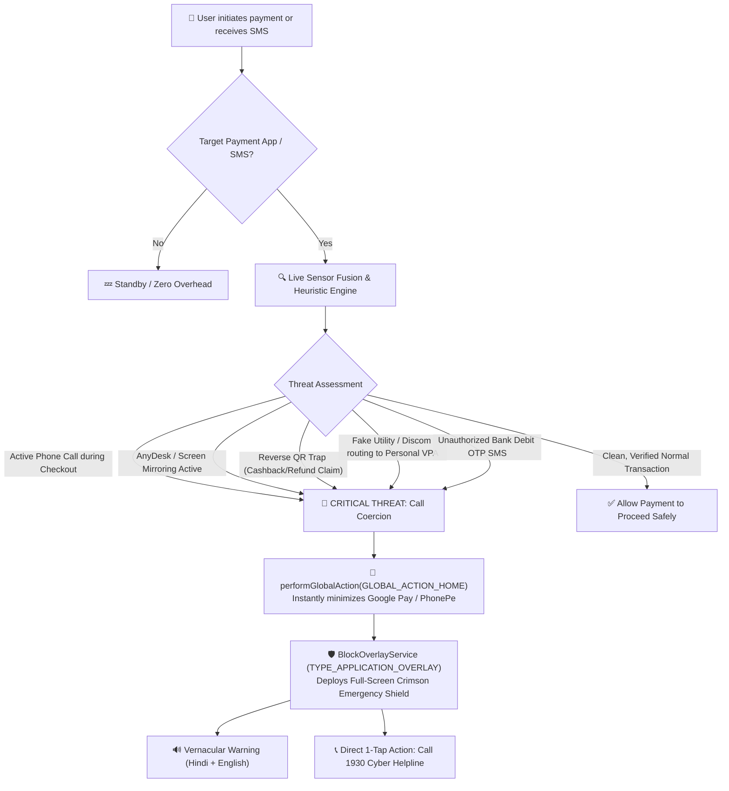

# 🛡️ Suraksha Guard (सुरक्षागार्ड)
### Real-Time Pre-Authorization Fraud Sentinel & UPI Payment Interceptor

[-3DDC84?logo=android&logoColor=white)](https://android.com)
[](https://kotlinlang.org)
[-4285F4?logo=jetpackcompose&logoColor=white)](https://developer.android.com/jetpack/compose)
[](https://react.dev)
[](#)
[](#)
[](docs/presentation.html)

---

## 📸 Real-World Protection & Live App Showcase

Suraksha Guard is a real-time, on-device security sentinel built to protect Indian citizens from social engineering coercion, fake utility bill scams, reverse-payment QR traps, and remote screen-sharing fraud. 

Rather than relying on passive warnings that users ignore in a panic, Suraksha Guard **physically minimizes the payment app** (`GLOBAL_ACTION_HOME`) and deploys a non-bypassable full-screen emergency shield **before the victim can enter their UPI PIN**.

| 🛡️ Multi-Screen Shield Dashboard | 💬 Emergency Bank Debit OTP Shield | 🚨 UPI QR Phishing Alert |
| :---: | :---: | :---: |
|  |  |  |
| *Figma-grade 4-tab UI with VPN Master Switch & Live Sensors* | *Unauthorized ₹25,000 debit OTP intercepted with bilingual alert* | *Active Google Pay transaction suspended on fake electricity QR* |

> 📊 **Interactive Slide Deck:** View the full project pitch deck in your browser: [docs/presentation.html](docs/presentation.html)

---

## 🎯 The Problem & The Critical Gap

Every 3 minutes, an Indian citizen loses money to digital fraud. Scammers exploit human psychological vulnerability rather than software cryptography:

1. **The Electricity Disconnection Panic:** *"Your power will be cut tonight at 9:30 PM. Pay ₹10 immediately to our DISCOM officer via Google Pay."*
2. **Reverse-Payment QR Traps:** Scammers send a payment QR claiming the victim will *"receive cashback / lottery winnings / refunds"* by scanning it and entering their PIN.
3. **Remote Desktop Coercion:** Victims are coerced over a phone call to install AnyDesk, TeamViewer, or QuickSupport, allowing scammers to view OTPs and account balances in real time.
4. **Bank Debit OTP Extortion:** Scammers initiate outbound transfers while keeping the victim engaged on a call, coercing them into sharing the debit authorization code.

> [!CAUTION]
> **The Flaw of Existing Banking Apps:** All current UPI apps show generic scam warnings on static splash screens. When a victim is on an urgent call or panic-scans a QR code, those passive warnings are completely ignored. **Zero apps actively halt the transaction at the point of payment authorization.**

---

## 💡 The Solution: How Suraksha Guard Works



---

## 📱 Figma-Grade Multi-Page Mobile Architecture

To avoid confusing users with too many details on one screen, the app is organized into **4 dedicated, distraction-free screens** via a glassmorphism bottom navigation bar:

### 1. 🛡️ Shield Tab (Main Dashboard)
- **VPN-Style Master Power Hero Switch:** Prominent, animated circular power switch with glowing neon emerald aura when armed. One tap to arm or pause all background sentinels.
- **Protection Health Overview:** Shows `100% GUARDED`, `PAUSED`, or `SETUP NEEDED` with quick-action shortcut.
- **Live Environment Telemetry Grid:**
  - 📞 **Active Phone Call Sensor:** Detects cellular, VoLTE, VoWiFi, and VoIP (WhatsApp) calls in real time.
  - 🖥️ **Remote Screen-Share Sensor:** Scans active AnyDesk, TeamViewer, RustDesk services, and virtual displays.
  - 🔍 **In-App Payment QR Sentinel:** Active screen reader monitoring Google Pay, PhonePe, and Paytm.
  - 💬 **Debit OTP Fraud Shield:** Real-time SMS interception of money deductions.
- **Mode Selector:** Toggle between **Live Fraud Protection** (silent, intercepts only genuine threats) and **🧪 Demo Simulation Mode**.

### 2. 🔍 QR Guard Tab (Dedicated Scam Detector)
- **Scam Showcase Presets:** Test common Indian scam patterns with one tap:
  - ⚡ **Fake Electricity Discom QR** (`BSES Power Bill`)
  - 🎁 **Cashback Trap QR** (`GooglePay Cashback Reward`)
  - 🔗 **Malicious APK Link QR** (`Customs Clearance bit.ly`)
  - ✅ **Clean Grocery Merchant QR** (`Sharma Kirana Store`)
- **Live Deep Analysis Card:** Displays risk score, scam classification, payee VPA, and bilingual English/Hindi breakdown.
- **Direct Blocker Preview Button:** Launch the exact full-screen emergency blocker for the inspected QR.

### 3. 🔒 Setup Tab (System Privileges Hub)
- **Progress Counter:** Visual badge showing privileges status (e.g. `4 of 4 Privileges Granted`).
- **Step-by-Step Permission Cards:**
  1. **Display Over Other Apps** (`SYSTEM_ALERT_WINDOW`)
  2. **Usage Access Sentinel** (`PACKAGE_USAGE_STATS` AppLock API)
  3. **In-App QR Protection** (`AccessibilityService` + Android 13/14 Restricted Settings 1-tap unlock guide)
  4. **Bank Debit OTP & Call Sensor** (`RECEIVE_SMS`, `READ_SMS`, `READ_PHONE_STATE`)

### 4. 🧪 Testing Tab (Threat Simulation Lab)
- **One-Tap Safe Simulators:**
  - 🛡️ **Payment Interception Shield:** Preview the Google Pay coercion safety shield.
  - 💬 **Bank Debit OTP Alert:** Test unauthorized ₹25,000 debit OTP SMS interception.
  - 📞 **Active Phone Call Alert:** Preview live call coercion warning.
  - 🖥️ **AnyDesk Screen-Share Alert:** Preview remote tool detection with the direct "Turn Off / Uninstall" action.
- **Built-in Safe Pass Architecture:** Explains the 2-minute "I am Safe" pass and the home-button automatic minimization feature.

---

## ✨ Core Defense Capabilities & Engineering

### 1. In-App Dynamic Screen Inspection (`PaymentMonitorService`)
- Extends native Android `AccessibilityService` configured with `typeWindowStateChanged` and `typeWindowContentChanged`.
- Performs recursive view tree traversal to inspect visible text nodes and content descriptions inside Google Pay, PhonePe, Paytm, and BHIM without requiring root.
- Debounced with a 5-second cooldown to eliminate CPU waste and prevent duplicate triggers.

### 2. Deep UPI & QR Threat Intelligence (`QrThreatEngine`)
- **Reverse-Payment Scam Detection:** Flags QRs disguised with keywords like `Cashback`, `Refund`, `Lottery`, `Prize`, `Reward`, `Winner`, or `Enter PIN to receive`. Reminds the user: *"In UPI, you never scan a QR or enter your PIN to receive money!"*
- **Utility / Discom Impersonation Engine:** Detects payees claiming to be electricity boards (`BSES`, `UPPCL`, `TNEB`, `Discom`) that route money to private Peer-to-Peer VPAs (`@ybl`, `@okaxis`, `@okhdfcbank`, `@paytm`).
- **Remote Access Coercion Check:** Detects `AnyDesk`, `TeamViewer`, `QuickSupport`, and `RustDesk` references embedded in notes or payee titles.
- **Malicious Deep-Link Scrutiny:** Inspects UPI `url` parameters for shortened links (`bit.ly`, `tinyurl`), direct `.apk` downloads, or IP-based hosts.

### 3. Active Phone Call & Screen-Sharing Sensors (`ThreatDetector`)
- **Active Phone Call Detection:** Combines:
  1. `TelecomManager.isInCall` (official Android telephony subsystem).
  2. `TelephonyManager.callState` (`CALL_STATE_OFFHOOK` or `CALL_STATE_RINGING`).
  3. `AudioManager.mode` checking `MODE_IN_CALL`, `MODE_IN_COMMUNICATION` (VoLTE / WhatsApp / VoIP), and `MODE_RINGTONE`.
- **Remote Tool & Mirroring Detection:**
  1. Checks `Settings.Secure.ENABLED_ACCESSIBILITY_SERVICES` for AnyDesk/TeamViewer plugins (`com.anydesk.anydeskandroid`, `com.anydesk.adcontrol.ad1`, `com.teamviewer.quicksupport.market`, `com.rustdesk.rustdesk`, etc.).
  2. Checks `UsageStatsManager` with a 30-minute recency window (`lastTimeUsed` and foreground events).
  3. Checks `DisplayManager.displays` for `MediaProjection` virtual displays, while filtering out internal OEM displays (fingerprint, AOD, etc.).

### 4. Real-Time Bank Debit OTP Sentinel (`DebitOtpEngine` & `SmsReceiver`)
- **Monetary Debit Isolation:** Listens for incoming bank SMS messages via `SmsReceiver` and parses OTPs authorizing outbound fund deductions (e.g. `debit of ₹25,000`, `fund transfer`, `spent on card`).
- **Zero False Alarms on Benign Messages:** Automatically ignores incoming credit alerts (`credited to account`) and non-financial login codes (`WhatsApp code`, `Zomato verification code`).
- **Active Call Correlation:** If a debit OTP is received while the user is actively on a phone call or while a remote tool is active, escalates the warning to **CRITICAL COERCION ALERT**.
- **Instant Full-Screen Shield:** Deploys the crimson emergency blocker immediately and plays an emergency warning tone warning the user never to disclose the OTP over phone calls or WhatsApp.

### 5. Non-Bypassable Emergency Shield (`BlockOverlayService`)
- Rendered using `WindowManager.LayoutParams.TYPE_APPLICATION_OVERLAY`.
- Bold, high-contrast red warning badge with clear explanation of the intercepted scam in both **English and Hindi**.
- Direct buttons:
  - **"🛡️ Close & Keep Me Safe"**: Closes the overlay safely while keeping the payment app closed.
  - **"🛑 Turn Off / Uninstall AnyDesk"**: Opens system settings directly to remove remote access apps.
  - **"📞 Call 1930 (Cyber Crime Helpline)"**: Launches immediate one-tap calling to India's National Cyber Crime reporting portal.
  - **"✅ I am Safe (2-Minute Pass)"**: Emergency temporary bypass if the user explicitly confirms a legitimate transaction.

---

## 📂 Repository Structure

```
SurakshaGuard/
├── README.md                                  # Complete project documentation
├── Suraksha Guard.apk                         # Signed release APK ready for installation (10.17 MB)
├── docs/
│   ├── presentation.html                      # Interactive 10-slide HTML pitch deck
│   └── images/
│       ├── app_dashboard_live.jpg             # Live multi-screen Shield dashboard screenshot
│       ├── app_debit_otp_alert.jpg            # Real-time bank debit OTP interception screenshot
│       ├── app_alert_screenshot.jpg           # UPI QR phishing alert screenshot
│       └── app_permission_screenshot.jpg      # Privileges onboarding screenshot
├── android/                                   # Native Android Project
│   ├── build.gradle.kts                       # Root project build script
│   ├── settings.gradle.kts                    # Gradle settings
│   └── app/
│       ├── build.gradle.kts                   # Dependencies (Compose BOM, Core KTX)
│       ├── src/
│       │   ├── main/
│       │   │   ├── AndroidManifest.xml        # Permission declarations & service configurations
│       │   │   ├── java/com/surakshaguard/app/
│       │   │   │   ├── MainActivity.kt        # Multi-page Jetpack Compose UI (4-Tab Architecture)
│       │   │   │   ├── PaymentMonitorService.kt # Real-time accessibility screen reader & sensor fusion
│       │   │   │   ├── QrThreatEngine.kt      # Heuristic UPI & QR threat intelligence
│       │   │   │   ├── DebitOtpEngine.kt      # Bank debit OTP extraction & entity parsing
│       │   │   │   ├── SmsReceiver.kt         # BroadcastReceiver for real-time bank SMS
│       │   │   │   ├── BlockOverlayService.kt # Full-screen emergency blocker overlay
│       │   │   │   ├── ThreatDetector.kt      # Telecom, Audio & Remote desktop sensor analyzer
│       │   │   │   └── UpiIntentInterceptorActivity.kt # Camera & link interceptor
│       │   │   └── res/
│       │   │       ├── xml/accessibility_service_config.xml # Accessibility settings
│       │   │       └── drawable/ic_shield_alert.xml # Red shield alert vector icon
│       │   └── test/java/com/surakshaguard/app/
│       │       └── ThreatDetectorTest.kt      # 28 Unit tests covering all fraud vectors & zero false-positives
│       └── surakshaguard.keystore             # Custom release signing keystore
└── src/                                       # Web Simulator (React + Vite + TypeScript)
    ├── App.tsx                                # Simulator orchestrator & state machine
    ├── components/                            # Phone frame, risk gauges, threat timeline
    └── engine/                                # Client-side risk engine & vernacular TTS
```

---

## 🚀 Installation & Quick Start

### Option A: Install Pre-Built Release APK (Recommended)
1. Download **[`Suraksha Guard.apk`](Suraksha%20Guard.apk)** from the root of this repository.
2. Install the APK on your Android device (Android 10+).
3. Open **Suraksha Guard** and grant the required permissions in the **Setup** tab:
   - **Display Over Other Apps** (`SYSTEM_ALERT_WINDOW`)
   - **Usage Access** (`PACKAGE_USAGE_STATS`)
   - **Accessibility Service** under *Downloaded Apps / Installed Services*
     *(If Android 13/14 shows "Restricted setting", tap "Step 1: Open App Info" in the app -> 3 dots (⋮) in top-right corner -> "Allow restricted settings")*.
   - **Bank Debit OTP & Call Sensor** (`RECEIVE_SMS`, `READ_PHONE_STATE`)
4. Open **Google Pay**, **PhonePe**, or **Paytm** and test any scam QR, or open the **Testing** tab to simulate full-screen alerts in one tap!

---

### Option B: Build Native Android App from Source

#### Prerequisites
- JDK 17
- Android SDK 34 (Android 14)
- Android Gradle Plugin 8.3+

```bash
# Navigate to the Android project folder
cd android

# Run all 28 unit tests to verify zero false positives
./gradlew testReleaseUnitTest

# Build the signed release APK
./gradlew assembleRelease
```
The output APK will be generated at:
`android/app/build/outputs/apk/release/app-release.apk`

---

## 🔒 Privacy & Permissions Transparency

Suraksha Guard is built following privacy-first and zero-knowledge principles:
- **Zero Cloud Transmissions:** All NLP and threat analysis runs 100% on-device. No payment notes, payee names, or personal financial data ever leave your phone.
- **PIN Isolation:** Suraksha Guard **never** has access to, nor does it request access to, UPI PIN entry screens (which are rendered inside secure, hardware-backed system windows by NPCI).
- **Targeted Monitoring:** Accessibility inspection is strictly restricted to designated UPI application package names (`com.google.android.apps.nbu.paisa.user`, `com.phonepe.app`, `net.one97.paytm`, `in.org.npci.upiapp`).
- **No Background Network Battery Drain:** Operates locally on system event hooks; zero continuous network polling.

---

## ⚖️ License
Distributed under the Apache 2.0 License. See `LICENSE` for more information.
