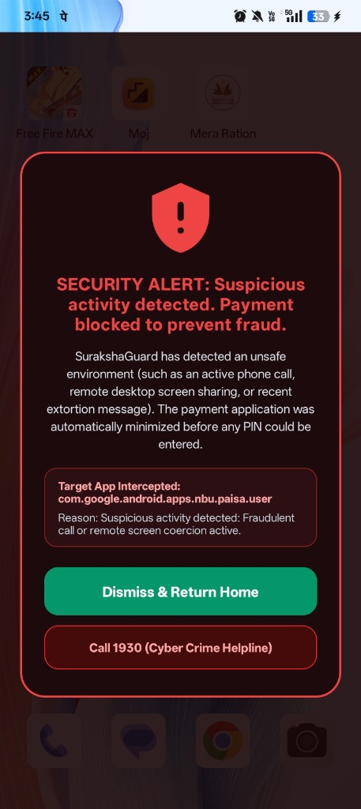
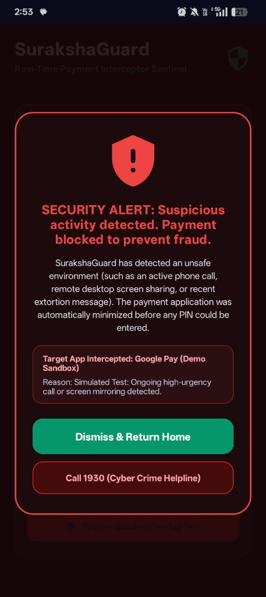
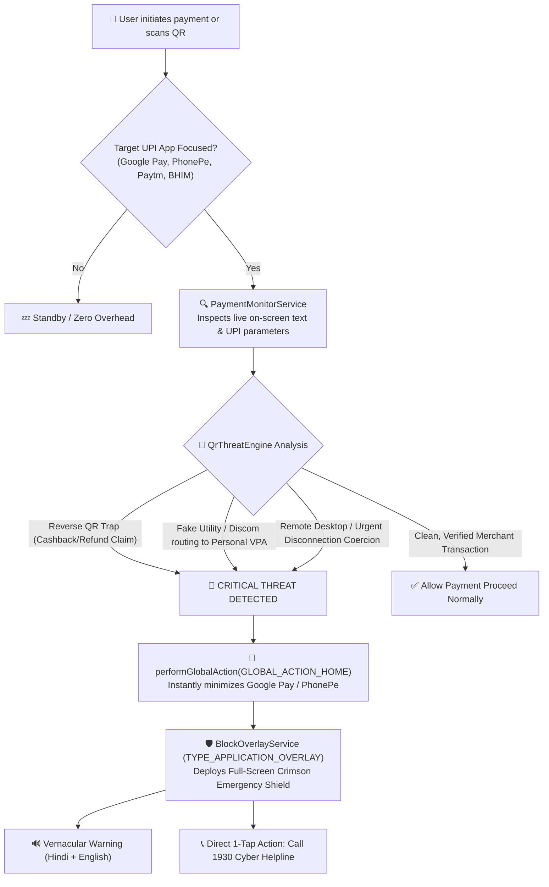

# 🛡️ Suraksha Guard (सुरक्षागार्ड)
### Real-Time Pre-Authorization Fraud Sentinel & UPI Payment Interceptor

[-3DDC84?logo=android&logoColor=white)](https://android.com)
[](https://kotlinlang.org)
[-4285F4?logo=jetpackcompose&logoColor=white)](https://developer.android.com/jetpack/compose)
[](https://react.dev)
[](#)
[](#)

---

## 📸 Project Overview & Live Screen Interception

Suraksha Guard is a real-time on-device security sentinel designed to protect Indian citizens from social engineering coercion, fake utility bill scams, reverse-payment QR traps, and remote screen-sharing fraud. 

Rather than relying on passive warnings that users ignore in a panic, Suraksha Guard **physically minimizes the payment app** and deploys a non-bypassable full-screen emergency shield **before the victim can enter their UPI PIN**.

| 🚨 Emergency Fraud Interception Screen | ⚙️ Security Permissions & Setup Screen |
| :---: | :---: |
|  |  |
| *Active Google Pay transaction suspended when fake QR/coercion is detected* | *Clear Jetpack Compose dashboard with Android 13/14 unlock guidance* |

---

## 🎯 The Problem & The Critical Gap

Every 3 minutes, an Indian citizen loses money to digital fraud. Scammers employ powerful social engineering tactics:
1. **The Electricity Disconnection Panic:** *"Your power will be cut tonight at 9:30 PM. Pay ₹10 immediately to our DISCOM officer."*
2. **Reverse-Payment QR Traps:** Scammers send a payment QR claiming the victim will *"receive cashback / lottery winnings / refunds"* by scanning it and entering their PIN.
3. **Remote Desktop Coercion:** Victims are coerced over a phone call to install AnyDesk, TeamViewer, or QuickSupport, allowing scammers to view OTPs and account balances in real time.

> [!CAUTION]
> **The Flaw of Existing Banking Apps:** All current UPI apps show generic scam warnings on static splash screens. When a victim is on an urgent call or panic-scans a QR code, those passive warnings are completely ignored. **Zero apps actively halt the transaction at the point of payment authorization.**

---

## 💡 The Solution: How Suraksha Guard Works

Suraksha Guard acts as an intelligent, non-intrusive on-device background sentinel.



---

## ✨ Core Features & Defense Capabilities

### 1. In-App Dynamic Screen Inspection (`PaymentMonitorService`)
- Extends native Android `AccessibilityService` configured with `typeWindowStateChanged` and `typeWindowContentChanged`.
- Performs recursive view tree traversal to read visible text nodes and content descriptions inside Google Pay, PhonePe, Paytm, and BHIM without requiring root.
- Debounced with a 5-second cooldown to eliminate CPU waste and prevent duplicate triggers.

### 2. Deep UPI & QR Threat Intelligence (`QrThreatEngine`)
- **Reverse-Payment Scam Detection:** Flags QRs disguised with keywords like `Cashback`, `Refund`, `Lottery`, `Prize`, `Reward`, `Winner`, or `Enter PIN to receive`. Reminds the user: *"In UPI, you never scan a QR or enter your PIN to receive money!"*
- **Utility / Discom Impersonation Engine:** Detects payees claiming to be electricity boards (`BSES`, `UPPCL`, `TNEB`, `Discom`) that route money to private Peer-to-Peer VPAs (`@ybl`, `@okaxis`, `@okhdfcbank`, `@paytm`).
- **Remote Access Coercion Check:** Detects `AnyDesk`, `TeamViewer`, `QuickSupport`, and `RustDesk` references embedded in notes or payee titles.
- **Malicious Deep-Link Scrutiny:** Inspects UPI `url` parameters for shortened links (`bit.ly`, `tinyurl`), direct `.apk` downloads, or IP-based hosts.

### 3. Non-Bypassable Emergency Shield (`BlockOverlayService`)
- Rendered using `WindowManager.LayoutParams.TYPE_APPLICATION_OVERLAY`.
- Bold, high-contrast red warning badge with clear explanation of the intercepted scam in both **English and Hindi**.
- Direct buttons:
  - **"🛡️ Close & Keep Me Safe"**: Closes the overlay safely while keeping the payment app closed.
  - **"📞 Call 1930 (Cyber Crime Helpline)"**: Launches immediate one-tap calling to India's National Cyber Crime reporting portal.
  - **"I am Safe (2-Minute Pass)"**: Emergency temporary bypass if the user explicitly confirms a legitimate transaction.

### 4. Real-Time Bank Debit OTP Sentinel (`DebitOtpEngine` & `SmsReceiver`)
- **Monetary Debit Isolation:** Listens for incoming bank SMS messages via `SmsReceiver` and parses OTPs authorizing outbound fund deductions (e.g. `debit of ₹25,000`, `fund transfer`, `spent on card`).
- **Zero False Alarms on Benign Messages:** Automatically ignores incoming credit alerts (`credited to account`) and non-financial login codes (`WhatsApp code`, `Zomato verification code`).
- **Active Call & Screen-Sharing Correlation:** If a debit OTP is received while the user is actively on a phone call or while a remote tool (`AnyDesk`, `TeamViewer`) is active, escalates the warning to **CRITICAL PHISHING/COERCION ALERT**.
- **Instant Full-Screen Shield & High-Priority Notification:** Deploys the crimson emergency blocker immediately and plays an emergency warning tone warning the user never to disclose the OTP over phone calls or WhatsApp.

### 5. Android 13/14 Restricted Settings Unlock Flow
- Complete, guided Jetpack Compose onboarding screen explaining how to grant accessibility and SMS permissions on modern Android versions where Google Play Protect flags sideloaded APKs with *"Restricted setting"*.

### 6. SurakshaPay Web Simulator
- Full React 18 + Vite + Tailwind CSS interactive dashboard under `src/` to simulate scam calls, SMS extortion, and UPI payment interceptions in a browser environment.

---

## 📂 Repository Structure

```
SurakshaGuard/
├── README.md                                  # Complete project documentation
├── Suraksha Guard.apk                         # Signed release APK ready for installation
├── docs/
│   └── images/
│       ├── app_alert_screenshot.jpg           # Live interceptor alert screenshot
│       └── app_permission_screenshot.jpg      # System permission overview screenshot
├── android/                                   # Native Android Project
│   ├── build.gradle.kts                       # Root project build script
│   ├── settings.gradle.kts                    # Gradle settings
│   └── app/
│       ├── build.gradle.kts                   # Dependencies (Compose BOM, Core KTX)
│       ├── src/
│       │   ├── main/
│       │   │   ├── AndroidManifest.xml        # Permission declarations & service configurations
│       │   │   ├── java/com/surakshaguard/app/
│       │   │   │   ├── MainActivity.kt        # Jetpack Compose UI & permission manager
│       │   │   │   ├── PaymentMonitorService.kt # Real-time accessibility screen reader
│       │   │   │   ├── QrThreatEngine.kt      # Heuristic UPI & QR threat intelligence
│       │   │   │   ├── DebitOtpEngine.kt      # Bank debit OTP extraction & call correlation
│       │   │   │   ├── SmsReceiver.kt         # BroadcastReceiver for real-time bank SMS
│       │   │   │   ├── BlockOverlayService.kt # Full-screen emergency blocker overlay
│       │   │   │   ├── ThreatDetector.kt      # Device call & screen-share state analyzer
│       │   │   │   └── UpiIntentInterceptorActivity.kt # Camera & link interceptor
│       │   │   └── res/
│       │   │       ├── xml/accessibility_service_config.xml # Accessibility settings
│       │   │       └── drawable/ic_shield_alert.xml # Red shield alert vector icon
│       │   └── test/java/com/surakshaguard/app/
│       │       └── ThreatDetectorTest.kt      # Unit test suite for zero false-positives
└── src/                                       # Web Simulator (React + Vite + TypeScript)
    ├── App.tsx                                # Simulator orchestrator & state machine
    ├── components/                            # Phone frame, risk gauges, threat timeline
    └── engine/                                # Client-side risk engine & vernacular TTS
```

---

## 🚀 Installation & Quick Start

### Option A: Install Pre-Built Release APK (Recommended)
1. Download **`Suraksha Guard.apk`** from the root of this repository.
2. Transfer and install the APK on your Android device (Android 10+).
3. Open **Suraksha Guard** and grant the required permissions:
   - **Display Over Other Apps** (`SYSTEM_ALERT_WINDOW`)
   - **Accessibility Service** under *Downloaded Apps / Installed Services*
   *(If Android 13/14 shows "Restricted setting", tap "Unlock Android 13/14" in the app -> 3 dots (⋮) in App Info -> "Allow restricted settings")*.
4. Open **Google Pay**, **PhonePe**, or **Paytm** and scan any test scam QR or enter a note like *"Urgent AnyDesk fee"* or *"Claim Cashback 500"*.
5. The payment app will immediately minimize, and the safety shield will deploy!

---

### Option B: Build Native Android App from Source

#### Prerequisites
- JDK 17
- Android SDK 34 (Android 14)
- Android Gradle Plugin 8.3+

```bash
# Navigate to the Android project folder
cd android

# Run unit tests to verify zero false positives
./gradlew testReleaseUnitTest

# Build the release APK
./gradlew assembleRelease
```
The output APK will be generated at:
`android/app/build/outputs/apk/release/app-release.apk`

---

### Option C: Run Web Simulator

```bash
# Install NPM dependencies
npm install

# Start local Vite development server
npm run dev
```
Open [http://localhost:5173](http://localhost:5173) in your browser to interact with the phone simulator and test different scam scenarios.

---

## 🔒 Privacy & Permissions Transparency

Suraksha Guard is built following privacy-first and zero-knowledge principles:
- **No Cloud Transmissions:** All NLP and threat analysis runs 100% on-device. No payment notes, payee names, or personal financial data ever leave your phone.
- **PIN Isolation:** Suraksha Guard **never** has access to, nor does it request access to, UPI PIN entry screens (which are rendered inside secure, hardware-backed system windows by NPCI).
- **Targeted Monitoring:** Accessibility inspection is strictly restricted to designated UPI application package names (`com.google.android.apps.nbu.paisa.user`, `com.phonepe.app`, `net.one97.paytm`, `in.org.npci.upiapp`).

---

## 📞 Cyber Fraud Support & Resources

If you have been a victim of cyber fraud or extortion:
- **National Cyber Crime Helpline:** Dial `1930` (toll-free across India)
- **Official Reporting Portal:** [https://cybercrime.gov.in](https://cybercrime.gov.in)
- **Golden Hour Rule:** Reporting financial fraud within 1-2 hours of unauthorized debit maximizes the chance of banks freezing stolen funds.

---

## 📄 License
This project is developed for educational, defense, and public safety research. Licensed under the [MIT License](LICENSE).

